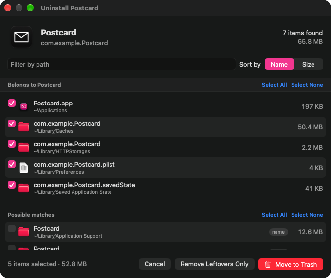
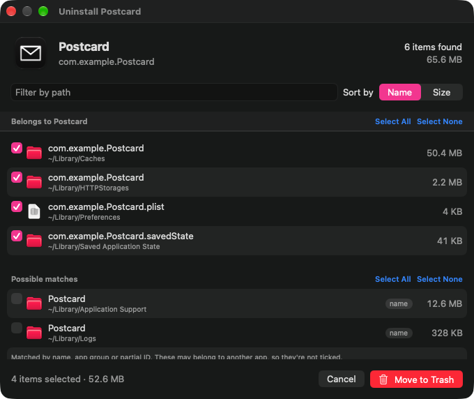
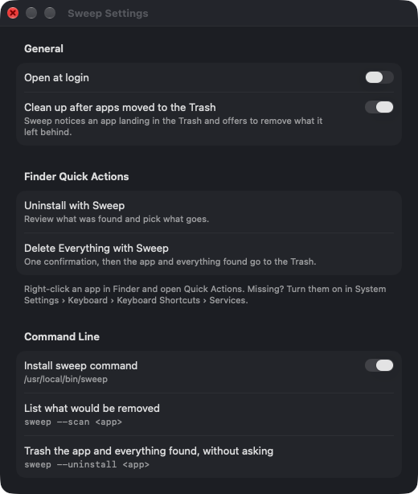

# Sweep

Sweep uninstalls Mac apps along with the files they leave in `~/Library` and `/Library`: preferences, caches,
containers, saved state, launch agents, logs, cookies. Everything goes to the Trash, so you can get it back.

It lives in the menu bar and also shows up in Finder's right-click menu. There's a command-line tool too.



## What it does

- Uninstall with review. Pick an app and Sweep lists the app plus everything it found, with sizes. Files that
  clearly belong to the app (matched by bundle ID) are ticked. Looser matches (by name, app group or part of the ID)
  are listed under "Possible matches" and left unticked, because they sometimes belong to a different app.
- Finder Quick Actions. Right-click an app, then Quick Actions › Uninstall with Sweep for the review window, or
  Delete Everything with Sweep to skip the list and confirm once.
- Drag and drop. Drop an app on the menu bar icon to open its review window.
- Trash watcher. If you drag an app to the Trash yourself, Sweep posts a notification saying what it left behind.
  Click it to clean up. You can turn this off in Settings.
- Find Leftovers. Lists files in `~/Library` named after apps that aren't installed any more. Nothing is ticked.
  Some of these are from command-line tools or background services rather than deleted apps, so read the list first.
- Undo. The menu bar offers to undo the last uninstall and moves everything back out of the Trash. This only lasts
  until Sweep quits.
- Remove Leftovers Only. Clears an app's settings and caches but keeps the app, for a fresh start.
- Command line. `sweep --scan <app>` prints what would be removed. `sweep --uninstall <app>` trashes the app and
  everything found without asking. Settings can link the command into `/usr/local/bin`.

Sweep won't touch Apple's apps or anything under `/System`, and it never offers the shared Library folders themselves
(Fonts, Keychains, Preferences and so on). Before removing anything it quits the app and unloads its launch agents.

## Where the rules come from

The matching rules are ported from AppCleaner 3.6.8, which I reverse-engineered to see what it looks for. Sweep is
stricter about what it ticks by default. AppCleaner will happily match `com.foo.Bar` against `com.foo.BarPro`, for
example; Sweep shows that match but leaves the decision to you. `HANDOFF.md` has the full list of differences.

## Install with Homebrew

The repository doubles as a Homebrew tap. Homebrew builds Sweep from source on your Mac, so it doesn't need to be
notarized.

```sh
brew tap pandeynmn/sweep https://github.com/pandeynmn/sweep
brew install --HEAD pandeynmn/sweep/sweep
```

That puts the `sweep` command on your PATH. For the menu bar app and the Finder Quick Actions, link the app into
`~/Applications` and open it once:

```sh
ln -sfn "$(brew --prefix)/opt/sweep/Sweep.app" ~/Applications/Sweep.app
open ~/Applications/Sweep.app
```

There's no tagged release yet, which is why `--HEAD` is needed. Upgrade with `brew upgrade --fetch-HEAD sweep`.
Homebrew's build is ad-hoc signed (it can't use my certificate), so macOS asks for App Management and Full Disk
Access again after every upgrade.

## Building

You need macOS 14 or later and Xcode's command-line tools. Open `Sweep.xcodeproj` and run, or use `build.sh`, which
compiles `Sources/*.swift` with `swiftc` and signs the bundle (Homebrew builds this way). The project is generated from
`project.yml`: run `xcodegen` after changing it. Both run SwiftFormat and SwiftLint when they're installed.

```sh
./build.sh                                        # builds build/Sweep.app
build/Sweep.app/Contents/MacOS/Sweep --selftest   # prints "ok"
./build.sh install                                # copies to ~/Applications, registers the Finder actions, launches
```

`build.sh` signs ad hoc unless `SIGN_ID` names a signing identity (`security find-identity -v -p codesigning` lists
yours). Ad-hoc builds work, but macOS ties privacy permissions to the code signature, so an ad-hoc build loses them on
every rebuild. Any Apple ID gets a free Apple Development identity: sign in under Xcode › Settings › Accounts, then
Manage Certificates › + › Apple Development.

## Permissions

macOS will ask you to allow Sweep under System Settings › Privacy & Security:

- App Management, to move apps to the Trash.
- Full Disk Access, for sandboxed apps' data in `~/Library/Containers` and for the Trash watcher.

Files owned by root go through Finder, which asks for your password.

## Screenshots

| | |
|---|---|
|  |  |

## License

Free for personal use. You can build, run, modify and share unmodified copies at no cost, but you can't sell it, use
it commercially or distribute modified versions without permission. See [LICENSE](LICENSE) for the exact terms.
